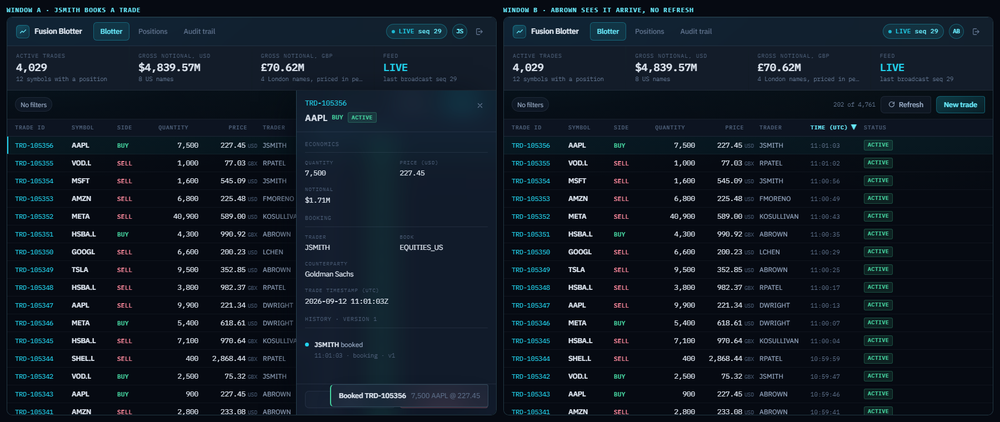

# Real-time equity trade blotter

View, create, amend and cancel equity trades. A change made in one window appears in every other
connected window without a refresh.



Next.js 16 and React 19 on the front. Behind
it, three ASP.NET Core services on .NET 10: a gateway, a trades service and a realtime service,
over SQL Server, RabbitMQ and Redis, with nginx at the edge. One `docker-compose.yml` runs the lot.

The backend was first written in Node (Express, Socket.IO, Prisma on Postgres) and then rebuilt as
these services with the same client contract. [`SUMMARY.md`](SUMMARY.md) describes the Node
backend as it was before the rebuild, and [what changed for clients](#what-changed-for-clients)
lists every difference a client can see.

## Run it

You need Docker with Compose v2 and port 80 free. There is no `.env` to create: compose carries
development values.

```bash
git clone <this repository>
cd real-time-equity-trade-blotter
docker compose up --build -d --wait
```

`npm run start` runs the same command. It builds four images, creates the databases and their
logins, applies both services' migrations, and waits until every service is healthy. The first
build takes several minutes; the SQL Server image alone is over 2 GB.

| | |
|---|---|
| Web app | <http://localhost> |
| Sign in | `jsmith` or `abrown` (traders), `mjones` (desk head), `viewer` (read only). Password `FusionDemo!2026` |
| Telemetry | <http://localhost:18888>, with the sign-in link from `docker compose logs aspire-dashboard` |
| Services | No published ports. nginx sends `/api`, `/health` and `/ready` to the gateway and `/hubs` to the realtime service |

Port 80 taken? `WEB_PORT=8088 PUBLIC_ORIGIN=http://localhost:8088 docker compose up --build -d --wait`.
The hub checks the browser's origin, which is why the second variable is there.

`docker compose down` stops the stack and keeps the data. `docker compose down -v` discards it.

An empty database is seeded with 500 trades across the five trading days before first start, plus
the four accounts. A simulated desk then books, amends and cancels every few seconds, so the blotter
moves on its own.

**To see the real-time behaviour:** open two windows, book a trade as `jsmith` in one and watch it
arrive in the other. Sign in as `viewer` to see the booking controls disappear. Sign in as `abrown`
to see another trader's trade greyed with "desk head only".

## Deploy to one EC2 instance

One x86 instance runs everything: a `t3.large` (2 vCPU, 8 GB) or larger, Ubuntu 24.04, 30 GB of disk.
SQL Server needs 2 GB of memory to itself. Open port 22 to your own address and port 80 to whoever
uses the blotter.

```bash
# Docker and Compose
sudo apt-get update && sudo apt-get install -y docker.io docker-compose-v2 git
sudo usermod -aG docker "$USER" && newgrp docker

# The code
git clone <this repository> blotter && cd blotter

# Real secrets, never the development fallbacks. PUBLIC_ORIGIN is the address people type.
cat > .env <<EOF
PUBLIC_ORIGIN=http://<the instance's public DNS name>
JWT_ACCESS_SECRET=$(openssl rand -hex 32)
JWT_REFRESH_SECRET=$(openssl rand -hex 32)
MSSQL_SA_PASSWORD=Sa_$(openssl rand -hex 16)
IDENTITY_MIGRATOR_PASSWORD=Im_$(openssl rand -hex 16)
IDENTITY_APP_PASSWORD=Ia_$(openssl rand -hex 16)
TRADES_MIGRATOR_PASSWORD=Tm_$(openssl rand -hex 16)
TRADES_APP_PASSWORD=Ta_$(openssl rand -hex 16)
RABBITMQ_PASSWORD=$(openssl rand -hex 16)
REDIS_PASSWORD=$(openssl rand -hex 16)
SEED_USER_PASSWORD=<a password for the four demo accounts>
EOF
chmod 600 .env

# Start
docker compose up --build -d --wait
```

The blotter is then at `http://<the instance's public DNS name>`. To update, `git pull` and run the
last command again; migrations run on every start and apply only what is new.

**Use TLS for anything real.** The refresh cookie is marked `Secure` in the Production
environment, as the Node API marked it. Browsers accept that on `http://localhost` but not on a
plain-HTTP public address, so over HTTP a page reload means signing in again. Put an Application
Load Balancer with an ACM certificate in front of port 80, or terminate TLS on the instance.

**The telemetry dashboard** listens on the instance's loopback only. Reach it over SSH with
`ssh -L 18888:127.0.0.1:18888 ubuntu@<host>`, then open <http://localhost:18888> and sign in with
the link from `docker compose logs aspire-dashboard`.

**Moving a service to another server** needs no code change. Every service finds the others through
an address in its environment (`TRADES_GRPC_URL`, `SQLSERVER_HOST`, `RABBITMQ_HOST`, `REDIS_HOST`,
and nginx's `GATEWAY_UPSTREAM`, `REALTIME_UPSTREAM` and `WEB_UPSTREAM`), each defaulting to its
in-compose name. Run the service on the new host with a published port, point the variable at it
in `.env` here, and restart.

## Where to find things

| Feature | Where it is |
|---|---|
| Trade blotter with sorting, filtering, refresh | <http://localhost>, `frontend/src/components/blotter/` |
| Create, amend, cancel | The ticket at `frontend/src/components/trade/`, the rules in `services/trades/src/Blotter.Trades/Services/` and `Domain/` |
| Live updates | `services/realtime/`, `frontend/src/providers/ConnectionProvider.tsx` |
| Trade model | `shared/src/schemas/trade.ts` for the client, `libs/Blotter.Contracts/` for the services' wire records and gRPC contract |
| Database design | `services/trades/src/Blotter.Trades/Data/` and `services/gateway/src/Blotter.Gateway/Data/`, each with its migrations, and `deploy/sqlserver/init.sql` |
| API design | [`docs/api_reference.md`](docs/api_reference.md): endpoints, payloads, filters, paging, errors, configuration |
| Unit and integration tests | [Running the tests](#running-the-tests) |
| Audit trail, positions, P&L, auth, validation, virtualised grid | All built. The `/audit` and `/positions` tabs, the sign-in page, and the decisions below |
| AI usage report and prompt log | [`docs/ai_usage_report.md`](docs/ai_usage_report.md), [`docs/prompt_log/`](docs/prompt_log/index.md) |

## Architecture

```
browser ──► nginx :80 ──┬── /api, /health, /ready ──► gateway ──gRPC──► trades ──► SQL Server: trades
                        │                               │                 │
                        │                               ▼                 ▼ outbox
                        │                    SQL Server: identity      RabbitMQ
                        │                         Redis                   │
                        ├── /hubs ──────────────► realtime ◄──────────────┘
                        │                           Redis: backplane, sequence, marks
                        └── everything else ────► frontend (Next.js)
```

```
frontend/            Next.js 16 App Router, React 19, Tailwind v4, TanStack Query and Table, @microsoft/signalr
shared/              @blotter/shared: the client's zod contract, one schema per model
services/gateway/    REST under /api/v1, sign-in and sessions, rate limits. Owns the identity database
services/trades/     The trade lifecycle, audit trail, positions and the simulated desk. Owns the trades database, serves gRPC
services/realtime/   The SignalR hub, the RabbitMQ consumer and the simulated marks. Keeps nothing but Redis
libs/                Blotter.Contracts (wire records, gRPC and broker contracts) and Blotter.ServiceDefaults
deploy/              The nginx template and the SQL Server init script
docs/                Specs, prompt log, AI usage report, API reference
```

Each decision states what was chosen and what it was chosen over.

**Three services, split by what changes together,** over one per entity. The gateway owns who you
are, the trades service owns what a trade is allowed to become, and the realtime service owns who
hears about it. Each has its own Dockerfile, its own database or none, and finds the others only
through addresses in its environment, so any of them can move to another host with no code change.

**REST at the edge, gRPC inside,** over REST everywhere. The browser's contract stays the Node API's
JSON byte for byte, while the gateway and the trades service share a typed `.proto` that fails the
build when either side drifts. The gateway forwards the caller's own token and the trades service
checks it again, so a missed check in one place is not a hole.

**An outbox, then RabbitMQ,** over publishing after the commit. The change and the message that
announces it commit in one transaction, and a dispatcher publishes in order with publisher
confirms, so a crash between the two loses nothing.

**SignalR with a Redis backplane,** over keeping Socket.IO. It is the .NET real-time stack, it scales
across realtime replicas through Redis, and the event names and payloads did not change. The
broadcast sequence is a Redis counter, so it survives a realtime restart.

**One SQL Server, a database and two logins per service,** over a server each. The migrator login
owns the schema and is used only by the one-shot migration job; the running service connects as a
login that can write its rows but cannot delete audit history, change the schema or switch the
append-only trigger off. One server keeps the single instance inside 8 GB.

**Migrations as a job, not a startup step.** Each service's image runs itself with `migrate`, so the
schema that ships is the one the code was built against, and no running replica races another to
migrate.

**Decimal end to end,** over doubles. Prices travel as exact decimal text on gRPC and as JSON
numbers written from `decimal` at the edge. A price with more than six places is rounded half away
from zero on the exact value, to the column's six places.

**Validation replays the shared Zod schemas,** over writing new rules from memory. The gateway's
FluentValidation rules are tested against 174 inputs that the shared schemas were run over, and CI
fails if the schemas change without the fixture being regenerated, so a ticket the frontend would
accept is never refused with different words.

**One origin, the services behind nginx,** over the browser calling services directly. No address
is compiled into the bundle, the refresh cookie needs no cross-site settings, and `/metrics` is
never forwarded. This narrows what is exposed rather than making the API private: authentication,
validation and rate limits carry the security.

**Keyset paging,** over offset. The blotter inserts rows all day, so an offset computed on one
request points somewhere else on the next. A cursor names a row.

**Cache patching, not refetching.** Every broadcast is applied to the cache in place, through one
`apply_trade` shared with the client's own mutations. A window left open makes no requests while the
link is healthy; it refetches only on a sequence gap or a reconnect.

**TanStack Table, headless,** over AG Grid. AG Grid brings its own theme and DOM, which would mean
design tokens fighting a third-party stylesheet. react-virtual handles the rows.

**Real authentication, three roles,** over none. `VIEWER`, `TRADER` and `ADMIN` map to named
permissions; routes require the permission, never the role, and a trader may act only on their own
trades. Access tokens are short-lived JWTs, refresh tokens rotate on every use, and a replayed
refresh token ends the whole session family.

**Amendment is a version, not a status,** over adding `AMENDED`. A trade is only `ACTIVE` or
`CANCELLED`, so an amendment increments `version`, writes an audit row, and the grid shows a `v2`
pill. A stale version is refused with 409.

**Append-only audit enforced by a database trigger,** over a convention. An audit trail the
application can rewrite is not an audit trail.

**Mutations blocked while disconnected, never queued,** over an offline queue. A confirmation for a
trade the server has not accepted is a worse failure on a desk than a disabled button, and the
button says why it is disabled.

**P&L on a simulated mark, labelled as such.** Average cost and realised P&L come from one walk the
trades service runs in `decimal` after every write; unrealised P&L is the client marking open size
against a mark that arrives over the hub. Every screen showing a mark says it is simulated.

**Filters and sort in the URL,** over component state. A filtered blotter is linkable, survives a
reload, and the back button undoes a filter.

**Prices in the instrument's currency.** London names quote in GBX (pence), as the exchange quotes
them, and the notional column shows pounds. The notional limit is per currency.

**Telemetry over OTLP,** over logs alone. All three services send traces, metrics and structured
logs to the Aspire dashboard, with one correlation id from nginx through the gRPC hop, and each
keeps a Prometheus `/metrics` on the internal network.

The two original design specs record the options the client-facing decisions were chosen from:
[the API](docs/superpowers/specs/2026-09-12-trade-api-design.md) and
[the interface](docs/superpowers/specs/2026-09-12-interface-behaviour-design.md).

## Running the tests

| Command | Covers | Needs | Result |
|---|---|---|---|
| `dotnet test --solution Blotter.slnx` | All four .NET suites against real SQL Server, RabbitMQ and Redis started by Testcontainers: the trade rules, repository, outbox and audit trigger; the hub's ordering, sequence and auth; the gateway end to end with the real trades service behind it; and the shared contracts | The .NET 10 SDK and a running Docker | 472 pass: gateway 334, trades 91, contracts 31, realtime 16 |
| `npm test` | The unit tiers of the web app and the shared contract: cache patching, the hub link's reconnects, formatting, flash, keyboard focus, date range, ticket validation and the position walk | Node 22, `npm install` | 255 pass: frontend 195, shared 60 |
| `npm run test:contract` | The Zod fixture the gateway is tested against still matches the shared schemas | Node 22, `npm install` | passes |
| `npm run test:e2e` | Playwright in two browser contexts against the running stack: live sync between clients, a concurrent amend refused with 409, the role rules, a dropped link blocking booking then resyncing, lockout, exposure, theme, filters and keyboard use | the compose stack | 18 pass |
| `npm run test:load` | k6, four virtual users for sixty seconds inside the rate limits | the compose stack and [k6](https://k6.io) | not re-run since the rebuild |
| `npm run test:lighthouse` | Lighthouse on the login page and the blotter | the compose stack | not re-run since the rebuild |

The browser tier needs Chromium once: `cd frontend && npx playwright install chromium`.

Three suites carry the real-time claim. `services/realtime/tests/` publishes to a real broker and
checks the hub's clients receive the trade, the audit row and the position in order with
consecutive sequence numbers. `frontend/e2e/liveSync.spec.ts` books in one real browser and watches
it arrive in another. `frontend/src/lib/query/applyBroadcast.test.ts` covers where a broadcast lands
in a sorted, filtered, paged view, and that a stale version is dropped.

The gateway's suite carries ports of the Node API's route, auth service, token, password, seed and
refresh-store tests. Two Node suites had nothing left to test: the Prisma user repository, whose one
behaviour the rehash tests now cover, and the Socket.IO polling handshake.

CI (`.github/workflows/ci.yml`) runs on every push: the .NET build with warnings as errors and all
four suites, the contract check, the web app's typecheck, lint and unit tier, a Trivy scan of each
image, a gitleaks secret scan, and the whole stack in compose with the browser suite against it.

### Other scripts

| Script | Does |
|---|---|
| `npm run start`, `npm run stop` | `docker compose up --build -d --wait`, and `docker compose down` |
| `npm run logs` | Follow the running stack's logs |
| `npm run dev:frontend` | `next dev` on <http://localhost:3000> with hot reload, forwarding `/api` and `/hubs` to the running stack |
| `npm run build` | Build the shared contract and the web app locally |
| `npm run typecheck`, `npm run lint` | The TypeScript workspaces |
| `node scripts/export_zod_cases.mjs` | Regenerate the gateway's Zod fixture after a schema change |

## What changed for clients

The routes, payloads, problem documents, cookies, headers and event names are the Node API's. These
are the differences a client can see:

- **The live link is SignalR at `/hubs/blotter`,** not Socket.IO at `/socket.io/`. The frontend
  changed in `createSocket.ts`, a new `keepConnected.ts`, `ConnectionProvider.tsx`, `package.json`,
  `proxyRoutes.ts` and `next.config.ts`; the e2e exposure check negotiates a hub connection instead of
  a Socket.IO handshake. A silent drop now shows within about 30 seconds rather than 45.
- **The stack answers on nginx at port 80,** not the web app on 3000. The e2e suite's default address
  moved with it.
- **A body that is not JSON answers 400, and one over 100 kB answers 413.** The Node API answered
  both with a 500.
- **An unreachable trades service answers 503** with code `internal`.
- **Prices with more than six decimal places are rounded on the exact decimal,** half away from
  zero, where the Node API rounded a double with `toFixed(6)`. Position arithmetic is in `decimal`
  too, so a last digit can differ from the Node API's double arithmetic.
- **A trade time is read as an ISO timestamp.** Legacy forms `Date.parse` also accepted, such as
  `2999-1-1`, are not, which only matters to the future-time check on input that already failed the
  format check.
- **An `x-request-id` outside `[A-Za-z0-9._:-]`, or over 128 characters, is replaced** with a fresh
  id rather than echoed into logs.
- **`JWT_REFRESH_SECRET` must differ from `JWT_ACCESS_SECRET`,** or the gateway refuses to start.
- **Trade ids keep counting past `TRD-999999`** instead of truncating.
- **The broadcast sequence survives a realtime restart.** It restarts only with Redis, and the
  client resyncs on a decrease as before.
- **The seeded trades differ,** because the generator is new; the four accounts are the same.
- **The refresh cookie's attributes are written in lower case** (`path=`, `samesite=lax`,
  `httponly`), which browsers treat the same.

## Assumptions

- A trade's `trader` comes from the access token, so you book as yourself and a client cannot
  send it.
- The browser reaches only nginx. Its public address has to be in `PUBLIC_ORIGIN`, because the hub
  checks the origin of every connection.
- The demo accounts share a documented password. They exist so whoever runs the stack can sign
  in to it, and nothing about that should survive a real deployment.
- Sessions live in Redis without persistence, so a Redis restart signs everybody out.
- The seed skips weekends but not exchange holidays, since a real calendar is per venue.
- All times are shown in UTC, because a session runs on the venue's clock, not the viewer's.

## Trade-offs accepted

- **The frontend follows React naming, the rest follows its platform.** In `frontend/`, state pairs
  are camelCase and component files PascalCase; `shared` keeps `snake_case`; the C# follows .NET
  conventions.
- **SQL Server Express,** which caps a database at 10 GB and the buffer pool at about 1.4 GB. A desk
  demo stays far below both; set `MSSQL_PID` for a licensed edition.
- **TLS is not terminated in the stack.** See [Deploy to one EC2 instance](#deploy-to-one-ec2-instance).
- **The telemetry dashboard keeps everything in memory,** so a restart clears it. A real deployment
  would send OTLP to a store.
- **The realtime queue drops what it cannot deliver within a minute,** and holds at most 10,000
  messages. A realtime service that was down that long has clients that resync on reconnect anyway.
- **One RabbitMQ node and one SQL Server,** each a single point of failure on a single instance.
- **The web app's Next.js 16.3.4 has published advisories,** fixed in 16.4. Upgrading the framework
  is its own change, so CI reports the web image's scan without failing on it until then.
- **The React Compiler is off.** TanStack Table v8 returns functions it cannot memoise.
- **Text filters match case-insensitive substrings,** which forgoes plain index seeks on those
  columns. Acceptable at the seeded dataset's size.
- **The e2e suite shares sign-ins** rather than isolating every test, because the gateway limits
  credential requests to ten a minute per address. Each test resets the page instead.
- **No market data feed.** Marks are a simulated walk, and the P&L is real arithmetic on simulated
  prices.
- **No column resizing, reordering, grouping or CSV export.** The grid sorts and filters, and
  nothing more.

## AI usage

AI-assisted development was used throughout, under a rule that no agent decides anything about the
system. Which tools, how, and where suggestions were taken or refused is in
[`docs/ai_usage_report.md`](docs/ai_usage_report.md). The prompts are in
[`docs/prompt_log/`](docs/prompt_log/index.md), including the instructions for the .NET rebuild and the
decisions taken on it.
